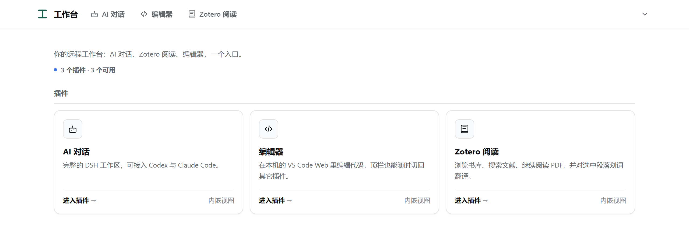

# AgentWorkbench

**English** · [简体中文](README.zh-CN.md)

A small, self-hosted workbench for reaching your own computer from anywhere: a
plugin host with one page per tool, designed for a private network (Tailscale)
and a slow, high-latency link.



Three plugins ship with it:

| Plugin | What it does | Needs on your machine |
|---|---|---|
| `agents` | The full DSH chat workspace, with Codex and Claude Code available as agents | `node` 18+, the DSH runtime (one `npm install`, see below) and a DeepSeek API key |
| `zotero` | Browse your Zotero library, read PDFs, translate a selection | the Zotero desktop app; selection translation additionally needs the *Translate for Zotero* plugin configured with a custom GPT / ChatGPT service |
| `vscode` | Edit code in VS Code Web, inside the shell (top-bar links stay available) | the VS Code CLI (`code`) |

A fourth plugin is a folder with two files. The host never imports a plugin by
name and never inspects its internals, so adding a tool does not mean editing the
host.

---

## How it is put together

```
browser ──HTTPS──▶ private reverse proxy ──▶ 127.0.0.1:8768  (host)
                                                     │
                           ┌─────────────────────────┼─────────────────────┐
                      static web/            /api/<plugin>          /<plugin>/
                           │                         │                     │
                     the shell + pages      plugin Python module     302 or link
```

- **One inbound surface.** The host binds `127.0.0.1` only. Remote access is a
  reverse proxy's job (Tailscale serve or any TLS terminator); nothing listens on
  a public interface.
- **The editor is relayed, not redirected.** `/vscode/` is proxied through the
  host — workbench assets, webview frames, web sockets and gzip included — so a
  phone reaches it on the same origin as everything else and needs no second
  exposed port.
- **`agents` needs its own origin.** DSH has no base-path option
  (`dsh web --help` has no such flag), so `/agents/` answers with a `302` to its
  own loopback port. Point the same reverse proxy at that port once; the other
  two plugins need nothing extra.
- **Manifests, not imports.** `GET /api/plugins` returns what the shell renders.
  The routing table is `plugins/*/plugin.json`.

## Requirements

- Python 3.10+ (the host and all bundled plugins use the standard library only)
- Optional, per plugin: `node` 18+ and the DSH runtime (agents), the Zotero
  desktop app (zotero), the VS Code CLI (vscode)

The host is plain Python and its test suite runs on both Windows and Linux in CI,
but day-to-day use is Windows: the launcher and remote-access helpers are
PowerShell scripts, and the `zotero` / `vscode` plugins look for Windows install
locations. On Linux or macOS the host and the shell work; those two plugins will
report why they are unavailable.

## Run it

```bash
git clone https://github.com/Zhang-Zhi-b-o/AgentWorkbench.git
cd AgentWorkbench
python -m workbench
```

Then open <http://127.0.0.1:8768/>. On startup the host prints where its data
lives and what it found for each plugin:

```
AgentWorkbench listening on http://127.0.0.1:8768
  data      /path/to/AgentWorkbench/data
  plugins   3 from /path/to/AgentWorkbench/plugins
  agents    iframe   /agents/           ready
  vscode    link     /vscode/           ready
  zotero    iframe   /plugins/zotero/   ready
```

A plugin whose dependency is missing is reported as `not available`; its card
stays disabled and says what is missing, and the rest keep working.

On Windows, `start.ps1` does the same thing from a shortcut: it reuses a healthy
running instance, starts one in the background if needed, then opens the browser.

### Install the DSH runtime (the `agents` plugin)

`agents` drives a local DSH install; it does not bundle one. Install it once into
the data directory, from the checkout root:

```bash
# Windows PowerShell
New-Item -ItemType Directory -Force data | Out-Null
npm install --prefix "$PWD\data\dsh-runtime" @deepseek-ai/dsh
```

```bash
# macOS / Linux
mkdir -p data
npm install --prefix "$PWD/data/dsh-runtime" @deepseek-ai/dsh
```

Creating `data/` first also pins `WORKBENCH_HOME` to this checkout (see below), so
the runtime lands exactly where the plugin looks for it. If you keep your data
somewhere else, install into `$WORKBENCH_HOME/dsh-runtime` instead.

The plugin then needs a DeepSeek API key; see [The DeepSeek key](#the-deepseek-key).
If either piece is missing, the disabled card and the `503` from `/agents/` both
print the exact command for your machine — you do not have to guess the path.

## Configuration

Everything machine-specific lives in the data directory, never in git.

| File | Purpose |
|---|---|
| `$WORKBENCH_HOME/plugins.json` | per-plugin settings (ports, CLI path, default folder, Zotero autostart) |
| `$WORKBENCH_HOME/agent-env.json` | the DeepSeek key for the `agents` plugin, `{"DEEPSEEK_API_KEY": "..."}` |
| `$WORKBENCH_HOME/remote-access.json` | the one private origin, `{"origin": "https://host:port"}` |

`WORKBENCH_HOME` defaults to a local `data/` directory when one exists, and to
the platform data directory (`%LOCALAPPDATA%\AgentWorkbench`,
`$XDG_DATA_HOME/AgentWorkbench`) otherwise. Move the checkout freely; only move
`data/` if you also set `WORKBENCH_HOME`.

Override the listen port with `WORKBENCH_PORT`.

Moving an existing installation on Windows? `sync-data.ps1` brings the DSH
conversations and runtime across, including the ~500 directory junctions that a
plain copy would either follow (and explode) or drop (and break the plugin
loader). A fresh install never needs it.

### `plugins.json`

```json
{
  "agents": { "port": 3080, "remote_port": 8770 },
  "vscode": { "port": 8799, "cli": "", "folder": "" },
  "zotero": { "autostart": true, "path": "" }
}
```

- `port` — loopback port the plugin owns.
- `agents.remote_port` — the port your reverse proxy exposes for DSH's own origin.
- `vscode.cli` — explicit `code.cmd` path; empty means "search `PATH` and the
  standard install locations".
- `vscode.folder` — default folder the remote file picker opens.
- `zotero.autostart` / `zotero.path` — start Zotero via its local API when it is
  closed, and where the executable is if autodetection fails.

### The DeepSeek key

The `agents` plugin injects a key into the DSH child process only. It is read
from `DEEPSEEK_API_KEY` (or `ANTHROPIC_AUTH_TOKEN`) in the environment first, then
from `agent-env.json`. It is never written to a response, a log, or the shell's
HTML. The endpoint is pinned to `https://api.deepseek.com`, and a redirect to any
other host is refused.

## Remote access

The host is loopback-only by design. To reach it from a phone or tablet, put a
private reverse proxy in front of it. With Tailscale:

```bash
# the workbench, including the proxied editor — this is the only entry a phone needs
tailscale serve --bg --https=8769 http://127.0.0.1:8768
# the agents plugin's own origin (DSH cannot be served under a path)
tailscale serve --bg --https=8770 http://127.0.0.1:3080
```

`setup-remote.ps1` runs both and writes `remote-access.json` for you.

Then write the shell's origin into `remote-access.json`:

```json
{ "origin": "https://your-machine.your-tailnet.ts.net:8769" }
```

The host accepts a request whose `Host` matches that origin, or a loopback host on
its own port. Anything else is rejected with `400`, and a foreign `Origin` header
gets `403`. That is what lets the page work from a phone while remaining
unreachable to a random web page on the same machine.

## Known limits

- **One person, one machine.** No accounts, no per-user isolation. Do not expose
  the host to the open internet; the reverse proxy is the security boundary.
- **The shell's interface is Simplified Chinese only.** The README is bilingual;
  the UI is not.
- **Pre-1.0.** Interfaces between plugins and the host, and the HTTP routes, may
  change in minor releases.
- **The bundled Zotero reader is a build artifact** (`web/zotero-reader/`,
  ~10 MB). See [NOTICE.md](NOTICE.md) for its provenance and build steps.

## Adding a plugin

Create `plugins/mytool/` with two files.

`plugin.json`:

```json
{
  "id": "mytool",
  "name": "我的工具",
  "description": "一句话说明",
  "icon": "box",
  "kind": "iframe",
  "entry": "/mytool/",
  "routes": ["/mytool", "/api/mytool"],
  "module": "mytool"
}
```

`kind` is one of:

- `iframe` — the shell embeds `entry` in a panel;
- `link` — the shell opens `entry` in a new tab;
- `redirect` — the host itself answers the path with a redirect.

`__init__.py` may define any of:

| Function | Role |
|---|---|
| `handle(request) -> bool` | serve a path you declared in `routes`; return `False` to fall through |
| `available() -> bool` | cheap probe used for the card's enabled state; must not start anything |
| `reason() -> str` | optional: one line explaining why `available()` is `False`, shown on the disabled card |
| `start()` / `stop()` | lifecycle, called with the host |
| `status() -> dict` | optional operational facts for your own debug endpoint |

`request` gives you `method`, `path`, `query`, `body`, `headers`, and four
responders: `json(status, payload)`, `text(...)`, `redirect(location)`,
`file(path, content_type=..., support_range=True)`. Raise
`workbench.errors.WorkbenchError(message, status, code)` for an expected failure
and the host formats it for the browser.

**No host change is needed.** Drop the folder in, restart, and the shell lists it.

## Security model

- Loopback bind only; remote access is delegated to a TLS-terminating proxy.
- `Host` and `Origin` allow-lists.
- Every mutating request must carry `X-Workbench: 1`
  (`X-Agent-Hub: 1` is still accepted for older scripts).
- JSON responses are recursively scrubbed: keys such as `api_key` and values that
  look like bearer tokens are replaced with `[REDACTED]`.
- Static paths are resolved under `web/`; traversal is rejected.
- Plugin status routes never return the browser hand-off token or the API key.

## Development

```bash
python -m pytest          # 40 tests: guards, routing, cache policy, plugins, end to end
```

CI runs the same suite on Windows and Linux for Python 3.10 and 3.12
([workflow](.github/workflows/tests.yml)); run it locally before pushing, since
the workflow is currently manual-triggered.

Layout:

```
workbench/     host: config, errors, plugin registry, request facade, server
plugins/       one package per plugin, each with plugin.json
web/           shell, plugin pages, and the bundled Zotero reader
web/zotero-reader/   official Zotero reader build (see NOTICE.md)
docs/          screenshot used above
tests/
```

## License

AGPL-3.0-or-later. Third-party components are described in [NOTICE.md](NOTICE.md).
